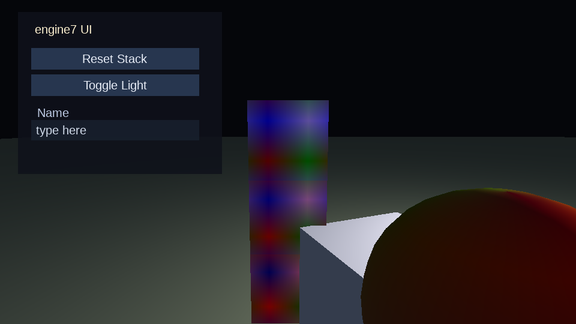

# engine7

A Zig workspace for the engine's scheduling, compilation, and runtime layers.

The three projects are independent Zig packages and also compose into one
workspace build:

| Package | Responsibility | Status |
| --- | --- | --- |
| `scheduler` | LAPACK/BLAS bindings, L-BFGS, two-view spectral partitioning | implemented, tested |
| `compiler` | lexer/parser, semantic analysis, bytecode lowering/optimizer | implemented, tested |
| `runtime` | bytecode -> LLVM IR -> ORC/LLJIT; imports `scheduler` and `compiler` | implemented, tested |
| `transpiler` | e7 shading subset (**e7s**) -> Khronos Slang modules | implemented, tested |

The parser implements the checked-in surface grammar: items, declarations,
layout and brace blocks, statements, patterns, types, and Pratt-parsed
expressions. The semantic analyzer adds scoped name resolution, unification-based
type inference, enum/struct checking, basic exhaustiveness, mutability checks,
and a place-based borrow checker. The backend lowers checked ASTs to a verified
intermediate bytecode; the runtime translates that bytecode to LLVM IR and runs
it through the iterative pass pipeline and LLJIT.

## Layout

```
.
├── build.zig              workspace composition and test aggregation
├── build.zig.zon
├── CITATIONS.bib          every external project/paper referenced by the code
├── grammar.ebnf           surface grammar (language design, not parser code)
├── editors/
│   ├── README.md          shared highlighting model + conventions
│   ├── samples/           shared parseable highlighting fixture
│   ├── neovim/            Neovim syntax plugin
│   └── vscode/            VS Code TextMate extension
├── scheduler/
│   ├── build.zig
│   └── src/
│       ├── lapack.zig     Fortran-ABI LAPACK/BLAS bindings + helpers
│       ├── lbfgs.zig      L-BFGS with two-loop recursion and Armijo search
│       └── spectral.zig   two-view BiSBM-style spectral partitioning
├── compiler/
│   ├── build.zig
│   └── src/
│       ├── syntax.zig     tokens and comptime keyword/operator tables
│       ├── ast.zig        full item/type/statement/expression/pattern AST
│       ├── lexer.zig      indentation-sensitive lexer (zpars lexical classes)
│       ├── parser.zig     recursive-descent + Pratt parser
│       ├── semantic.zig   public semantic-analysis API
│       ├── semantic/
│       │   ├── types.zig  shared type graph, unification, substitution
│       │   └── analyzer.zig scopes, inference, exhaustiveness, borrows
│       ├── bytecode.zig   bytecode format, verifier, fixed-point optimizer
│       ├── codegen.zig    checked AST -> bytecode lowering
│       ├── pipeline.zig   source -> parse -> semantics -> bytecode
│       └── iterative.zig  fixed-point LLVM New Pass Manager driver
└── runtime/
    ├── build.zig
    ├── vendor/
    │   ├── vulkan/        vendored Khronos Vulkan headers (Apache-2.0)
    │   └── vk_video/      Vulkan video codec headers
    └── src/
        ├── bytecode_ir.zig bytecode -> textual LLVM IR
        ├── task.zig       stackful task runtime, work-stealing queue, triggers
        ├── aggregate.zig  heap slots, strings, vectors/matrices, maps
        ├── orc.zig        LLVM ORC LLJIT bindings; absolute-symbol registration
        ├── intrinsics.zig e7_* C ABI manifest + LLVM IR declarations
        ├── jit_tests.zig  ORC tests that call the ABI from generated IR
        ├── ffi/
        │   ├── abi.zig    status codes, allocation, last-error buffer
        │   ├── io.zig     process-wide std.Io + mutex helpers
        │   ├── handles.zig opaque u64 handle tables
        │   ├── time.zig   monotonic/wall clocks and sleep
        │   ├── sdl.zig    shared SDL3 + Vulkan C import
        │   ├── window.zig SDL3 window creation and events
        │   ├── vulkan.zig instance/device/swapchain + RGBA capture
        │   ├── fs.zig     sandbox rooted at the executable directory
        │   ├── stdio.zig  stdin/stdout/stderr reads, writes, and line input
        │   ├── dl.zig     dlopen/LoadLibrary, symbols, trampolines, data I/O
        │   ├── net.zig    TCP/UDP over std.Io.net
        │   ├── http.zig   HTTP/HTTPS through libcurl
        │   ├── quic.zig   QUIC client/server over ngtcp2 + OpenSSL
        │   ├── webrtc.zig WebRTC data channels over libdatachannel
        │   └── testdata/  self-signed QUIC test certificate
        └── root.zig       re-exports scheduler/compiler and the runtime API
```

## Toolchain

- Zig **0.16.0**
- LLVM **23.1.3** (`llvm-config --version`), linked as `LLVM-23`
- System LAPACK and BLAS (`-llapack -lblas`)
- SDL3 (`-lSDL3`) for windows, events, and Vulkan surface creation
- Vulkan loader (`-lvulkan`); the Khronos headers are vendored under
  `runtime/vendor/vulkan` so the build does not depend on a `vulkan-headers`
  package being installed
- libcurl (`-lcurl`) for HTTP/HTTPS
- OpenSSL (`-lssl -lcrypto`) and ngtcp2 with its OpenSSL crypto adapter
  (`-lngtcp2 -lngtcp2_crypto_ossl`) for QUIC
- libdatachannel (`-ldatachannel`) for WebRTC data channels
- Slang (`slangc`, optional): validates the e7s shader transpiler output and
  the checked-in shader sources; it is not needed to build the workspace or
  run the Zig tests

Both `compiler` and `runtime` link `libLLVM`. If your distribution exposes a
different LLVM major version, update the `linkSystemLibrary("LLVM-23", ...)`
calls in their `build.zig` files. LAPACK/BLAS must likewise provide `liblapack`
and `libblas` link names; point the build at a different name if your system
only ships versioned shared objects. The runtime's FFI link names live together
in [`runtime/build.zig`](runtime/build.zig); adjust them if your distribution
ships differently named shared objects.

## Build and test

From the workspace root:

```sh
zig build test
```

The root build composes the dependency modules and runs each package's tests.
Individual packages work standalone as well:

```sh
(cd scheduler && zig build test)
(cd compiler  && zig build test)   # fetches zpars on first build
(cd runtime   && zig build test)
```

The first compiler build downloads and pins `zpars` at the commit recorded in
`compiler/build.zig.zon`.

## Editor support

[`grammar.ebnf`](grammar.ebnf) also drives editor syntax highlighting. The
plugins under [`editors/`](editors/README.md) implement the same lexical model
and highlighting heuristics:

- [`editors/neovim/`](editors/neovim/README.md) — a legacy Neovim `:syntax`
  plugin (no tree-sitter parser needed) with filetype detection for `.tri`
  (canonical) plus `.e7` and `.engine7` aliases, and comment/indent filetype
  settings.
- [`editors/vscode/`](editors/vscode/README.md) — a declarative VS Code
  extension (TextMate grammar + language configuration + snippets) that
  contributes language id `engine7` and scope `source.engine7`.

Both are tested against the shared, compiler-parseable fixture
[`editors/samples/kitchen_sink.tri`](editors/samples/kitchen_sink.tri). From the
repository root:

```sh
bash editors/verify.sh
```

The VS Code suite installs `vscode-textmate` and `vscode-oniguruma` into
`editors/vscode/node_modules` on first run; the Neovim suite only needs
`nvim --headless`.

## Design decisions

### How the projects compose

`runtime/src/root.zig` imports the sibling package modules:

```zig
pub const scheduler = @import("scheduler");
pub const compiler = @import("compiler");
```

Those names are wired in `runtime/build.zig` from path dependencies, so
`runtime` is genuinely downstream of both other projects rather than a copy of
their APIs. `scheduler` and `compiler` do not depend on `runtime`.

### Scheduler

`lapack.zig` declares the reference Fortran symbols directly
(`dgesv_`, `dsyev_`, `dgemm_`) and converts between row-major Zig matrices and
column-major LAPACK matrices at the boundary. `solve` and `symmetricEigen` are
the safe helpers; the raw declarations stay public for advanced callers.

`lbfgs.zig` implements the limited-memory BFGS two-loop recursion with a
bounded correction history and a backtracking Armijo line search. A failed
curvature check discards the history instead of injecting an indefinite pair.

`spectral.zig` implements the requested two-view extension of the BiSBM
spectral method. For each view `v` it builds the degree-normalized bipartite
adjacency `B_v`, forms

```
S_rows = (1/2) * (B_1 B_1^T + B_2 B_2^T)
S_cols = (1/2) * (B_1^T B_1 + B_2^T B_2)
```

then takes the top eigenvectors of each symmetric similarity matrix with
LAPACK `dsyev`, row-normalizes the spectral embedding, and runs deterministic
k-means++/Lloyd on both sides. This follows the single-view construction in
Braun [braun2023]; averaging the view-specific similarities is our multi-view
extension, not an additional theorem from that paper. The paper's consistency
analysis is not reproduced here.

### Compiler

The language has statement forms (bindings, assignments, `ret`/`break`/`cont`,
loops) and expression forms; `if` and `match` can be used as expressions. A
block is a statement list whose final expression supplies the block's value.
Significant indentation is tokenized as `newline` / `indent` / `dedent`; blank
and comment-only lines do not change the indentation stack, and tabs in
indentation are rejected.

The surface grammar lives in [`grammar.ebnf`](grammar.ebnf).  It covers
Rust-like modules/visibility, expression-only `if`/`match`, significant
indentation with brace alternatives, `<-`/`:=` bindings, aggregate type
declarations, generic inherent impls, and the contextual `sys` query/resource
parameters.  Types cover inferred/specified errors, optionals, references,
boxes, raw pointers, and `(A, B) -> T` function types.  Function expressions
use the declaration form without the name:
`(a: i32) -> i32 = a + 5`.

The lexer uses the [`zpars`](https://codeberg.org/quint/zpars) comptime parser
combinator library for lexical classes (identifiers, digits, floats,
exponents). `zpars` was chosen over older Zig combinator libraries because its
current source targets Zig 0.16 and its combinators are pure comptime types.
`zpars` handles the lexical classes; `parser.zig` is a hand-written
recursive-descent parser for items/declarations and a Pratt parser for the
recursive expression grammar. It consumes the lexer's virtual layout tokens and
treats explicit brace blocks as layout-insensitive. `syntax.zig` centralizes
the keyword and multi-character operator tables; `ast.zig` defines the full
node set.

`iterative.zig` links LLVM's New Pass Manager and runs a pipeline repeatedly
until the printed module reaches a fixed point or the iteration budget is
exhausted. This is the in-process iterative-compilation framework used by the
compiler; later profile-guided or search-based pipeline selection can replace
the fixed pipeline string without changing the loop.

### e7s -> Slang transpiler

[`transpiler/`](transpiler/README.md) is a separate package that transpiles the
e7 shading subset (**e7s**) to Khronos Slang modules.  It reuses the real front
end (`compiler/src/parser.zig`) and adds no grammar: shader-specific extensions
are e7 attributes (`@binding(binding, set)`, `@push_constant`, `@vertex`,
`@fragment`, `@compute(x, y, z)`, `@location`, `@builtin`, `@flat`, `@inline`),
and resources are ordinary top-level `name: Type` declarations carrying binding
attributes.  Traits and `impl` blocks lower to Slang interfaces and extensions;
generics, bounds, and modules are preserved (external `mod foo` loads nested
`foo/main.e7` (or sibling `foo.e7`) and emits `foo.slang` + `import foo;`; inline modules become Slang
namespaces).  Where the two languages differ, e7s takes the Slang meaning:
vectors are `float3`-style values, `[f32; 4, 4]` is `float4x4`, struct literals
reorder to declaration order, and matrix `*` is emitted as `mul(...)`.

```sh
(cd transpiler && zig build)
transpiler/zig-out/bin/e7s transpile transpiler/examples/triangle.vert.e7 -o /tmp
transpiler/zig-out/bin/e7s transpile transpiler/examples/modules/main.e7 -o /tmp/e7s-out
slangc -target spirv -profile spirv_1_5 -entry vs_main -stage vertex \
       -I /tmp/e7s-out -o /tmp/triangle.spv /tmp/e7s-out/main.slang
```

[`transpiler/docs/e7s.md`](transpiler/docs/e7s.md) is the language reference;
[`transpiler/docs/slang-notes.md`](transpiler/docs/slang-notes.md) records the
Slang forms verified against slangc 2026.20.  After building, `sh
transpiler/tools/validate-examples.sh` transpiles every example and compiles
all shader entries to SPIR-V when a `slangc` is available.

### Semantic analysis

`semantic.zig` exposes `analyze(allocator, module)`. The implementation is split
so type machinery is shared rather than duplicated:

- `semantic/types.zig` owns the type graph, integer/float inference variables,
  unification, directional assignment compatibility, generic substitution, and
  type formatting.
- `semantic/analyzer.zig` owns scopes, type definitions, callable signatures,
  expression/statement/pattern checking, generic environments, and the borrow
  checker.

The analyzer performs:

- lexical scope and declaration checking;
- inference and unification for locals, literals, branches, lists, calls, and
  generics;
- struct/enum/table/trigger field and variant checks;
- type constructors for `[T]` dynamic vectors, `[T; N]` mathematical vectors,
  `[T; N, M]` matrices, `map[K, V]` hashmaps, and built-in `str`;
- built-in vector/matrix arithmetic: componentwise `+`/`-`/`/`, dot products,
  matrix-vector, vector-matrix, and matrix-matrix multiplication, and scalar
  scaling;
- operator traits (`Add`, `Sub`, `Mul`, `Div`, `Neg`, `PartialEq`, `PartialOrd`,
  `Deref`, `Index`) implemented with `impl Trait for Type`;
- static `impl` method resolution;
- contextual `sys` query/resource parameter checking;
- module namespacing with nested modules, qualified paths, module-relative
  unqualified resolution, `use` aliases/groups/globs, and `crate::` paths;
- marker traits, `impl Trait for Type`, supertraits, and generic/`where` bound
  checking at type uses and at explicit or inferred function call sites;
- reachability/exhaustiveness for bools, enums, optionals, structs, and
  open-ended integer matches, including duplicate/unreachable arm detection;
- mutability checks for bindings, fields, dereferences, and reference
  parameters;
- borrow tracking by place (root binding plus field/index/deref projections).
  Loans live to the end of the statement unless promoted into a binding. Locals
  are released at their last use in a block (an NLL-style approximation), while
  binding-owned loans still end with their scope. Conflicting shared/mutable
  borrows, mutation while borrowed, reads while mutably borrowed, and returning
  borrows of locals are diagnosed;
- move tracking for non-`Copy` named values and boxes, with use-after-move,
  move-while-borrowed, reinitialization, call/return/struct/list moves, and
  conditional block-tail moves;
- item/statement source spans on diagnostics, so messages carry line/column;
- async effect checking:
  - `async` declarations and function expressions;
  - prefix `await`/`spawn`/`detach`/`cancel`;
  - implicit `Cancelled!` task results;
  - async-only context checks;
  - no reference parameters/results on ordinary async functions;
  - external loans cannot cross `await`; task-local loans are permitted.

Current semantic limits: visibility is parsed but not enforced; traits are
marker-style (method signatures/bodies are not part of trait declarations);
region inference is block/last-use rather than full CFG-based; moves are
tracked at whole-binding granularity rather than partial fields; task affinity
metadata is not yet propagated through handles; and custom `Index` key/result
signature coverage remains partial.

### Compilation pipeline and bytecode

[`pipeline.zig`](compiler/src/pipeline.zig) is the real compilation entry point:

```text
source -> parser -> semantic analysis -> codegen -> bytecode optimizer -> verified bytecode
```

- [`bytecode.zig`](compiler/src/bytecode.zig) defines a versioned stack-machine
  bytecode (`E7BC`), a CFG/stack verifier, binary encode/decode, and a
  fixed-point constant-folding/peephole optimizer.
- [`codegen.zig`](compiler/src/codegen.zig) lowers scalar control flow,
  functions/tasks/triggers, and heap-backed aggregates: struct/table
  field layout, enum tags and payloads, vectors/matrices, strings, maps,
  field/index assignment, references, and raw pointers. Scalars are i64;
  aggregates are heap pointers to 64-bit slots.
- [`runtime/aggregate.zig`](runtime/src/aggregate.zig) defines the aggregate
  ABI: `[length, elements...]` strings/vectors, `[rows, columns, elements...]`
  matrices, tagged enum/struct slots, and a small linear hashmap.
- [`runtime/bytecode_ir.zig`](runtime/src/bytecode_ir.zig) materializes the
  operand stack as an `alloca` array and translates every bytecode instruction
  to LLVM IR. `Jit.addBytecode` runs the compiler's iterative LLVM pipeline over
  that IR to a fixed point before adding it to LLJIT.

Aggregate operators (`+`, `-`, `*`, `/`) are lowered through runtime helpers:
vector/matrix componentwise operations, dot products, matrix/vector products,
matrix multiplication, scalar scaling, string concatenation, and map access.
Custom operator traits (`Add`, `Sub`, `Mul`, `Div`, `Neg`, `PartialEq`,
`PartialOrd`, `Deref`, `Index`) are lowered to calls to their impl methods;
unused impl methods are not emitted. Built-in operators take precedence for
primitive/container types.

### Unsafe code and uninitialized declarations

```text
load <- (p: *raw T) -> T:
    unsafe:
        out: T
        out = *p
        ret out
```

- `unsafe:` introduces an unsafe block.
- `name: T` declares a mutable but initially undefined local; reading it before
  assignment is a definite-assignment error.
- Raw pointer dereference and raw pointer arithmetic require unsafe context.
- Raw pointers use the same 8-byte slot ABI as other values; `p + 1` advances by
  one slot.
- `&place`, `*pointer`, field/index assignment, struct literals, enums, vector
  and matrix literals, map literals, and string literals all lower to the
  aggregate ABI.

### Aggregates, iteration, and references

- Matrices support `m[i]` row reads, `m[i, j]` element reads/writes, and
  `m[i] = row` row assignment.
- `for (key, value) in map:` iterates insertion-ordered map entries; vectors
  support `for value in vec:` and `for (index, value) in vec:`; strings support
  `for ch in text:` and `for (index, ch) in text:`.
- Built-in container methods: `text.len()`, `text.slice(start, end)`,
  `text.char_at(i)`, `vector.len()`, and `map.len()`.
- References to aggregate locals are object aliases (`r := &p; r.x`); scalar
  references point at their slot; `&mut` field mutation through parameters is
  supported. Whole-value assignment through an aggregate reference is rejected
  rather than miscompiled.
- Aggregate field/index reads and writes lower to heap slots; whole-value
  assignment through a reference remains an explicit unsupported case.

### Async tasks and triggers

```text
load <- async (path: str) -> Bytes:
    ...

Update <- trigger
    amount: i32

@trigger(Update)
Apply <- sys():
    await load("level")

run <- async () -> Bytes:
    await Update(10)
```

- `async` adds the built-in `Cancelled` error to the task result. Calls produce
  lazy, move-only `Task<T>` handles.
- `await`/`spawn`/`detach`/`cancel` are prefix expressions.
- [`task.zig`](runtime/src/task.zig) implements stackful tasks with `ucontext`
  stacks, per-worker deques, work stealing, a global injector queue, and
  awaiter wakeups.
- [`lease.zig`](runtime/src/lease.zig) tracks exclusive leases. A task releases
  its held leases when it suspends at `await`, reacquires them on resume, and
  releases them permanently when its body returns.
- Normal `sys` declarations lower as async constructor/body pairs. Systems
  receive ECS resources, query handles, and `Commands` through generated
  prologues; `select` handles can be iterated with
  `for (a, b) in query` / `for row in query`, binding mutable or shared
  component references.
- Trigger declarations are callable with normal function-call syntax and return
  an awaitable task.
- Trigger execution spawns all systems registered with `@trigger(...)`, waits
  for all of them, and completes only after the last system finishes.
- Trigger invocations coalesce one active plus at most one pending invocation;
  the runtime unit test verifies that four concurrent invocations execute as two
  barrier invocations.
- Dropping/awaiting a canceled lazy task returns the cancellation sentinel;
  `?` propagates it as the implicit `Cancelled` error.
- `detach` moves a task out of structured ownership and schedules it.

Current async limits: trigger fields are not bound into system parameters;
trait-object query projections stay opaque; task thread affinity, task-local
reference affinity, structured-scope/drop tracking, and running-task
cancellation are not yet implemented; async function expressions are lowered
only when bound at top level.

### Engine scaffold

[`engine/`](engine/README.md) contains the e7-side engine scaffold and the
sample UI/ECS surface:

- [`engine/main.e7`](engine/main.e7) — resources (`Window`, `Input`, `Time`,
  `Gpu`), `@Components` component structs, an auto-collected `Components` table,
  `Commands`, systems, plugins, and the frame loop.
- [`engine/ui/`](engine/ui) — the `Ui` plugin, trait dependencies and
  required methods: `UIRenderable <- trait : UIElement` with
  `render <- async (&self, &mut Gpu) -> !nil`, plus `res`/`select` sys
  parameters, `@plugin`, and `Commands` resource insertion.
- The front end parses `mod`, `plugin`, `@plugin`, `await query &mut Commands`,
  `disown`, `select ... where has`, row literals, unit-struct shorthand,
  `@Components`, table `...` auto-columns, and newline-separated sys
  parameters.
- [`engine/shaders/`](engine/shaders) — e7s shader sources and checked-in
  SPIR-V for the cube/point-light pipeline; `shaders/build.sh` runs the e7s
  transpiler and `slangc` to regenerate the runtime assets.

The e7 engine project runs directly through the JIT host:

```sh
zig build run-engine                     # interactive: WASD, Q/E, Shift, mouse look
zig build run-engine -- --frames 120
zig build run-engine -- --headless --capture /tmp/engine.ppm
zig build shaders                        # e7s -> Slang -> SPIR-V
zig build run-scene                      # native renderer demo/fallback
```

`run-engine` loads the `engine/` module tree (`main`, `events`, `ecs`, `gfx`,
`time`, `window`, `input`, `camera`, `scene`, `bootstrap`, `ui`) as a project,
initializes the columnar ECS world, JITs the e7 `main`, and runs the `Init`,
`FrameInit`, `PreUpdate`, `Update`, `PostUpdate`, `Render`, and `DeInit`
triggers. SDL
window/input and Vulkan scene access are compiler-known intrinsics
(`e7_engine_*`); the ECS/Commands/plugin/query runtime is in
[`runtime/src/ecs.zig`](runtime/src/ecs.zig). Engine libraries are organized by behavior (`events`, `ecs`, `gfx`, `time`,
`window`, `input`, `camera`, `scene`, `physics`, `bootstrap`, `ui`), with each
exposing a plugin; `main.e7` is the demo-specific composition point.

`@derive(Serialize, Deserialize)` is supported on ECS/engine structs and
`json_encode(value)` / `json_decode::<T>(text)` round-trip primitives, strings,
nested derived structs, and vectors through a compiler-generated schema.

The engine libraries now also include an `obj.e7` Wavefront parser,
PNG/JPEG image-loading intrinsics (`e7_image_*`), an `AssetsPlugin`, and a
`physics.e7` library with `RigidBody`, box/sphere/capsule/plane colliders,
AABB/sphere raycasts, gravity integration, pickup/hold, and a camera raycast
resource. `physics_broadphase.e7` maintains a spatial grid with aggregated
region/ray candidate queries; `physics_narrowphase.e7` provides oriented
capsule/OBB/SAT manifolds, quaternion orientation, rotated world inverse
inertia, multi-point box contact impulses, and true capsule/plane,
capsule/AABB, sphere/plane and box/plane tests. Contact points drive box
tipping/rolling; Coulomb friction uses μ=0.9 dynamic/1.15 static at every
contact. Pickup selects the nearest body with a deterministic tie-break.
Pickup, hold, and camera follow share that step. The demo starts with a static
plane, a rotation-locked capsule player, a dynamic ball, and three stacked
cubes.

The UI library (`engine/ui/`) provides font-backed text rendering, panels,
labels, buttons with action IDs and a `UIButtonPressed` trigger, and editable
text fields with mouse focus/typing/Backspace/Enter. Text rasterizes through
SDL3_ttf into image handles, uploads via `Gpu.upload_texture`, and is cached in
`UIState`; screen-space drawing uses `Gpu.draw_ui_quad` over the 3D scene.

Engine intrinsics are wrapped in e7 inherent methods (`window.pump()`,
`gpu.begin_frame()`, `gpu.draw_renderable(...)`, `image.upload_texture(gpu)`,
`mesh.upload(gpu)`); raw `e7_engine_*`/`e7_image_*` calls live only inside those
wrapper implementations.

Rendering selects per-object geometry through
`e7_engine_scene_draw_shape_tex` (box/sphere/capsule/plane) with RGB tint and
GPU texture; sphere/capsule/plane are real procedural meshes rather than box
proxies. OBJ meshes upload through `e7_engine_scene_mesh_upload` and draw with
`e7_engine_scene_draw_custom`; per-frame object count is dynamic rather than
capped at 64. ECS supports component add/remove/despawn, so gameplay markers
such as `Held` are added and removed dynamically instead of remaining permanent
append-only rows.

Engine policy now lives in e7: shader asset selection/loading
(`e7_engine_read_shader`), `gather_input`, time updates, camera look/movement,
rigid-body rotation, light animation, ECS queries, and render submission all live in the
the nested `engine/` modules. `runtime/src/engine.zig` is limited to SDL/Vulkan
window/scene/time/raw input/asset-read/frame-state/frame-limit and capture
facilities; `e7_engine_scene_draw` has been replaced by separate
`set_cube_angle`, `set_light`, `begin_frame`, `draw_mesh`, and `end_frame`
intrinsics dispatched by e7.
[`runtime/src/ffi/renderer.zig`](runtime/src/ffi/renderer.zig) owns the
depth-tested cube/point-light raster pipeline and the SPIR-V shader modules.



### Runtime

`orc.zig` wraps `LLJIT`: it parses textual IR, sets the host triple and data
layout, transfers a threadsafe module to the main `JITDylib`, and resolves
symbols to callable addresses. `Jit.addBytecode` is the compiler-facing entry:
bytecode -> LLVM IR -> iterative LLVM optimization -> LLJIT. Compiled code and
its module live until `Jit.deinit`.

`Jit.defineSymbols` publishes host entry points as ORC absolute symbols, so
JITed code can call runtime services without relying on `-rdynamic` or on the
host executable exporting them. `Jit.addLibrary` installs LLVM's dynamic
library search generator for a specific shared object, so IR can declare an
ordinary C function (`declare double @cos(double)`) and have ORC resolve it
from that `.so`/`.dylib`/`.dll`; `Jit.addProcessSymbols` additionally reflects
symbols already loaded into the process. [`intrinsics.zig`](runtime/src/intrinsics.zig)
maintains the complete `e7_*` manifest (`symbols()`) and a matching LLVM IR
declaration block (`declarations`). [`jit_tests.zig`](runtime/src/jit_tests.zig)
compiles IR that calls the filesystem, TCP, UDP, HTTP, SDL window, Vulkan probe,
QUIC, and WebRTC entry points.

The FFI layer under `runtime/src/ffi/` provides:

| Area | Backend | Intrinsics |
| --- | --- | --- |
| windows/events | SDL3 | `e7_window_*` |
| Vulkan surface + capture | Vulkan | `e7_vk_*` |
| filesystem | Zig `std.Io.Dir` | `e7_fs_*` |
| standard I/O | Zig `std.Io.File` | `e7_stdio_*` |
| dynamic C libraries | `dlopen`/`LoadLibrary` + ORC generators | `e7_dl_*`, `e7_ffi_call*`, `e7_ffi_read/write` |
| TCP/UDP | Zig `std.Io.net` | `e7_tcp_*`, `e7_udp_*` |
| HTTP/HTTPS | libcurl | `e7_http_*` |
| QUIC | ngtcp2 + OpenSSL | `e7_quic_*` |
| WebRTC data channels | libdatachannel | `e7_rtc_*` |

The filesystem sandbox interprets every path relative to the directory
containing the running executable. Absolute paths, `..` components, and
symlinks that canonicalize outside that directory are rejected. This is a
capability boundary for generated code, not a defence against a hostile
same-user process with direct syscall access. See
[`runtime/README.md`](runtime/README.md) for the ABI contract, limitations, and
a minimal JIT usage example.

## Verification

`zig build test` runs 355 tests: scheduler 8, compiler 207, runtime 117,
transpiler 23.

- scheduler: LAPACK solve/eigen checks, L-BFGS quadratic and Rosenbrock
  minimization, two-view block recovery, dimension validation;
- compiler: layout tokenization, comments/blank lines, strings/floats/operators,
  bracket continuation, indentation errors, all declaration forms, braces and
  layout blocks, patterns and guards, type constructors, expression precedence,
  function expressions, sys queries, table ellipsis validation, iterative
  pipeline fixed point, invalid IR, plus semantic tests for inference, generics,
  structs/enums, module resolution/globs, trait bounds, move semantics,
  exhaustiveness/reachability, mutability, borrow conflicts/release/escape,
  source spans, vectors/matrices/maps/`str`, matrix indexing, built-in vector/
  matrix arithmetic and 2D indexing/row assignment, custom operator/Index
  lowering, unsafe blocks, uninitialized declarations, raw pointer arithmetic,
  aggregation, map/vector/string iteration and container methods, aggregate
  references, async/await/spawn/cancel/trigger semantics, sys lowering, leases,
  trait dependencies/required methods, plugin/query/disown/Commands DX, bytecode
  round-trip/verification/optimization, lowering, and end-to-end JIT execution;
- transpiler: e7s lowering golden tests for functions, structs, vectors and
  matrices, resources and bindings, vertex/fragment/compute entries, traits and
  extensions, generics and bounds, modules (external and inline), constants,
  enums, control flow, match, plus diagnostics for unsupported e7 features; the
  examples are additionally validated end to end with slangc 2026.20
  (`transpiler/tools/validate-examples.sh`);
- runtime: sibling imports, LLJIT compilation/lookup/call, invalid IR, absolute
  host-symbol registration, bytecode-to-IR execution, async task execution,
  inline async functions, canceled tasks, triggers and trigger coalescing,
  struct/field assignment, enums and enum matches, vectors/matrices/dot/matrix
  products, matrix 2D indexing/row assignment, strings, maps (including string
  keys), map/vector/string iteration, container methods, aggregate references,
  unsafe raw pointers, uninitialized locals, normal sys lowering, lease
  release/reacquire, a Vulkan cube/point-light scene renderer (headless
  capture and JIT scene ABI), ECS resources/rows/Commands/plugins/queries,
  executable e7 engine project (headless capture + injected input/camera),
  filesystem sandbox
  escapes, STDIO file/line handling and JITed stderr writes, shared-library
  loading, symbol resolution, `cos`/`strlen` calls, data-symbol access,
  JIT-callback `qsort`, TCP/UDP loopback,
  HTTP request/response, SDL window lifecycle, Vulkan device probing, QUIC
  client/server handshake and stream exchange, WebRTC
  offer/answer/data-channel loopback, and JITed IR calling each of those
  intrinsic families.

## Next steps

1. Add expression-level spans and multi-label diagnostics.
2. Add f32 arithmetic lowering so e7 can own camera/rotation/light animation,
   bind trigger fields to system parameters, and complete trait-method receiver
   lowering/object-safe trait queries.
3. Add task-local reference affinity, structured scopes, and running-task
   cancellation; release early-break query handles promptly.
4. Feed runtime profile counters into iterative pipeline selection.
5. Enforce visibility and add trait method signatures/bodies plus object-safe
   trait values.
6. Move region inference to a CFG-based liveness/borrow analysis and track
   partial field moves.
7. Expand the scheduler's spectral path to sparse matrices and larger `k`.

## Citations

All external software and papers are listed in [`CITATIONS.bib`](CITATIONS.bib).
Code comments cite keys such as `[braun2023]`, `[anderson1999]`, `[llvm]`, and
`[zpars]`.
