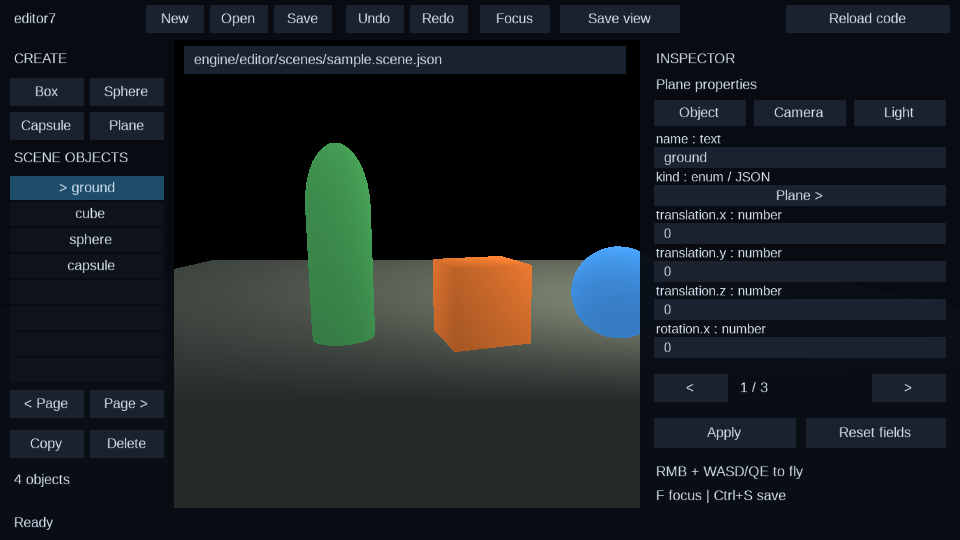

# e7 scene editor

The editor is a normal e7 project (`engine/editor_main.e7`) compiled and run by
a Zig host (`runtime/src/editor_run.zig`).  The host owns the compiler/JIT
integration and the code-swap loop; everything user-facing (scene rendering,
selection, property editing UI, document handling) is written in e7 on top of
the engine modules.

```
engine/editor_main.e7        project root: modules + host-facing `main` loop
engine/editor/main.e7        Editor plugin/systems, responsive workspace and input
engine/editor/model.e7       document commands, validation, history, picking
engine/editor/inspector.e7   reusable schema-driven JSON fields and patching
engine/scene/main.e7         scene library module root
engine/scene/document.e7     scene file format, JSON (de)serialization, helpers
engine/editor/scenes/        checked-in sample scene documents
runtime/src/editor_run.zig   compile/JIT/reload host (`zig build run-editor`)
```

The workspace in action (headless capture from `zig build run-editor -- --frames 3
--headless --reload-test --capture`; scene rendered by the engine renderer, side
panel drawn by the e7 UI library):



## Host bridge (Zig side)

`editor-run` mirrors `engine-run`: it compiles the project with
`compiler.pipeline.compileProject`, registers ECS metadata, encodes bytecode,
creates an ORC JIT, and awaits the compiled async `main`.  It adds the
reload loop and three host capabilities the editor needs:

| e7 native method | runtime symbol | purpose |
| --- | --- | --- |
| `host::read_asset(path)` | `e7_engine_read_shader` | read a cwd-relative file (scene JSON, OBJ, shaders) |
| `host::write_asset(path, text)` | `e7_engine_write_asset` | create/truncate a cwd-relative file (scene saves) |
| `host::list_dir(path)` | `e7_engine_list_dir` | one-level directory listing (fs list format) |
| `host::request_reload()` | `e7_host_request_reload` | request an in-process code swap |
| `host::take_reload_request()` | `e7_host_take_reload_request` | consume the request from the e7 loop |

`e7_engine_write_asset` returns 0 on success / -1 on I/O failure; the scene
library turns that into a status line in the editor.

### Code hot-swap model

The e7 editor `main` loop checks `host::take_reload_request()` after `Render`.
When set, it runs `DeInit` (releasing the window/scene) and returns the reload
marker `42`.  `editor_run` then:

1. drops the current JIT and compiled project,
2. recompiles the project from disk,
3. resets/re-registers ECS metadata for the new generation,
4. creates a fresh JIT and starts the new `main`.

`--reload-test` seeds one request before the first run so the swap path is
exercised in headless verification (`zig build run-editor -- --frames 3
--headless --reload-test`). Reload restarts the whole editor loop. The reload
action saves the document first, then stores an opaque JSON session through `host::set_reload_state`;
`host::reload_state` restores the active path, selection, and viewport in the
new JIT. The host copies these bytes and clears them on host reset. Undo/redo
history starts fresh after a code reload. Preserving the ECS world and swapping
only changed systems remain future work.

## Scene file format (version 1)

Scene documents are JSON serialized with the e7 `@derive(Serialize,
Deserialize)` + `json::encode` / `json::decode::<T>` support.  The format is
additive, versioned, and rejects unknown versions.  Every field is required
(no implicit defaults on load); the editor always writes complete documents.

```json
{
  "format": "engine7-scene",
  "version": 1,
  "name": "sample",
  "camera": {
    "position": { "x": 0.0, "y": 1.8, "z": 6.0 },
    "yaw": 0.0, "pitch": -0.15,
    "fov_y": 1.0471975512, "near": 0.1, "far": 100.0
  },
  "light": {
    "position": { "x": 3.0, "y": 4.0, "z": 2.0 },
    "colour": { "x": 1.0, "y": 0.9, "z": 0.8 },
    "intensity": 2.8
  },
  "objects": [
    {
      "name": "cube",
      "kind": "Box",
      "translation": { "x": 0.0, "y": 0.5, "z": 0.0 },
      "rotation": { "x": 0.0, "y": 20.0, "z": 0.0 },
      "half_extents": { "x": 0.5, "y": 0.5, "z": 0.5 },
      "colour": { "r": 1.0, "g": 0.55, "b": 0.22, "a": 1.0 },
      "texture": ""
    }
  ]
}
```

* `format` is always `"engine7-scene"`; `version` is `1`.
* `kind` is a tagged enum: `"Box"`, `"Sphere"`, `"Capsule"`, `"Plane"`.
* `rotation` is Euler degrees (intrinsic X, then Y, then Z), converted on apply
  to the renderer's `BodyOrientation` quaternion.
* `half_extents` is the renderer's half-size (world units); a plane uses a thin
  y extent.
* `texture` is reserved for an AssetServer image key (`"cube/cube.png"`) or
  `""` for the built-in white texture.  The editor stores it; wiring it to
  the GPU texture/material is follow-up work.
* Unknown fields are skipped by the decoder; a future format bump adds
  migration rather than silently half-loading.

The checked-in example is `engine/editor/scenes/sample.scene.json`; the
in-code `sample_scene()` mirrors it so a missing/read-only working file still
opens a useful scene.

### ECS mapping

`EditorRefresh` rebuilds the scene rows from the document:

| document | ECS rows |
| --- | --- |
| camera | one `Camera` |
| light | one `PointLight` |
| object | `Transform`, `BodyBounds`, `Material`, `Renderable`, `BodyOrientation`, `EditorObject` |

The scene renderer (`engine/gfx/scene.e7::render_scene`) consumes exactly these
components, so the editor uses the same rendering path as the engine demo
(no editor-only renderer).

## Authoring workflow

Run `zig build run-editor` from the repository root. The initial document is
`engine/editor/scenes/sample.scene.json`. The viewport uses the engine renderer;
left/right panels anchor to window edges when resized (960×540 or larger is
recommended). Shared rendering supports 256 object slots, 256 textures, 256 UI
quads, and 512 total draws per frame.

* Create Box, Sphere, Capsule, and Plane objects. Use the paged hierarchy or
  click viewport object bounds to select; Copy and Delete operate on selection.
* Choose **Object**, **Camera**, or **Light** in the inspector. Fields come
  from `json::schema::<T>()`, including nested property paths. Use `<` / `>`
  to page through every field; pending values survive page changes. Booleans
  and unit enums cycle on click. Other fields accept text (JSON for containers,
  optionals, and enum payloads). Click **Apply** to commit all pages together;
  **Reset fields** discards pending values. Apply before changing the selection
  or target, which starts a fresh draft. Typed JSON decoding validates field
  types before scene rules run. Names must be unique, sizes positive, tint in
  0..1, and camera clipping valid. Object rotation uses degrees; camera angles
  and FOV use radians. FOV and clipping now affect the rendered camera.
* Hold RMB over the viewport to look and fly with WASD and Q/E; Shift accelerates.
  Release RMB to use the UI. **Focus** / F frames selection. Navigation is
  transient; **Save view** explicitly writes it into the document's camera.
* **Undo/Redo** (Ctrl+Z / Ctrl+Y) keeps up to 64 document snapshots, including
  creation/deletion and inspector transactions. Selection alone is not an edit.
* Edit the path above the viewport and click **Save** (Ctrl+S when no field is
  focused) for Save As, or **Open** to load it. New/Open require a second click
  to discard unsaved document changes. Invalid files and failed saves leave the
  current document intact. The title's `*` tracks edits against the last save;
  rebuilding viewport rows does not clear it.
* Ctrl+D duplicates, Delete removes, Ctrl+N creates a scene, and Ctrl+O opens
  the path. Shortcuts are disabled while a text field has focus.
* **Reload code** saves successfully before requesting a fresh compile/JIT.
  The active path, selection, and viewport survive the reload.

The inspector implementation knows no scene types: any derived record can use
`inspect_fields(schema, source)`, `inspect_values(&fields)`, and
`inspect_patch(source, &fields, &values)`, then decode the candidate as its own
type. Adding a serializable field requires no inspector layout/field-index
change. Scene-specific constraints stay in `editor/model.e7`; see
[JSON reflection](json.md#schema-reflection-and-inspectors) for the API contract.
Numeric fields retain their serialized precision, and unchanged spans are kept.

`editor/model.e7` is independent of widgets and GPU access. UI buttons and
shortcuts dispatch the same commands. Scene edits request `EditorRefresh`,
which rebuilds only scene ECS rows. UI labels/field textures are invalidated
when their values change. Demo light animation lives in the demo project so
it cannot change the editor's authored light.

## Validation

`zig build test-e7 -- --filter editor` exercises document commands, bounded
history, independent duplication, paged camera/light/object transactions, save/open
failures, reload sessions, and picking. `--filter inspector` also covers unrelated
derived records, escaped strings, booleans, payload enums, and typed containers. `zig build test` also compiles and runs
the complete editor across two JIT generations and checks its capture.

## Current boundaries

* Scene objects are render-only; gameplay components, physics authoring, and
  play/stop simulation are not yet part of the document format.
* Texture keys are preserved but not resolved/uploaded by the editor yet.
  Object alpha is serialized; the current opaque 3D material path does not blend it.
* Selection uses oriented authoring bounds, rather than exact mesh triangles.
* Panels use a compact anchored layout; no docking, gizmo handles, asset browser,
  file chooser, or filesystem watcher is implemented yet.
* Code reload restarts the world and clears undo history. Scene files are the
  durable persistence boundary; sessions live only in the host process.
