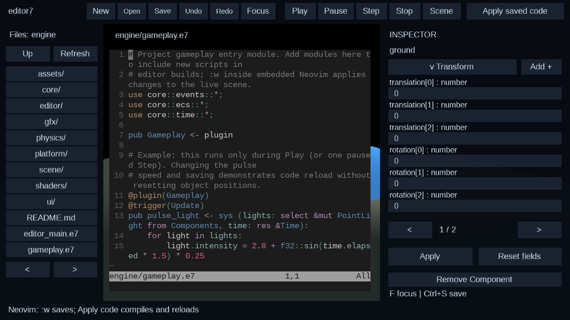

# e7 scene editor

The editor is a normal e7 project (`engine/editor_main.e7`) compiled and run by
a Zig host (`runtime/src/editor_run.zig`).  The host owns the compiler/JIT
integration and the code-swap loop. Scene UI, workspace policy, and document
handling are written in e7; the native terminal bridge hosts Neovim.

```
engine/editor_main.e7        project root: modules + host-facing `main` loop
engine/editor/main.e7        Editor plugin/systems, responsive workspace and input
engine/editor/model.e7       document commands, validation, history, picking
engine/editor/inspector.e7   reusable schema-driven JSON fields and patching
engine/editor/components.e7  compiler catalogue, default construction, dynamic JSON
engine/editor/authoring.e7   component transactions and legacy scene adapters
engine/editor/workspace.e7   file browser, terminal UI, play/pause, reload requests
engine/editor/workspace_model.e7 pure path and runtime-component transformations
engine/editor/neovim.vim     embedded Neovim settings and successful-save notification
engine/gameplay.e7           imported gameplay entry module
runtime/src/editor_host.zig  e7 terminal API and compile callback
runtime/src/editor_terminal.c PTY/libvterm and single-image text rasterization
engine/scene/main.e7         scene library module root
engine/scene/document.e7     scene file format, JSON (de)serialization, helpers
engine/editor/scenes/        checked-in sample scene documents
runtime/src/editor_run.zig   resident editor host (`zig build run-editor`)
runtime/src/live_reload.zig  staged JIT generations and ABI compatibility checks
runtime/src/code_dispatch.zig atomic function/task entry publication
```

The workspace in action (headless capture from `zig build run-editor -- --frames 3
--headless --reload-test --capture`; scene rendered by the engine renderer, side
panel drawn by the e7 UI library):




## Host bridge (Zig side)

`editor-run` mirrors `engine-run`: it compiles the project with
`compiler.pipeline.compileProject`, registers ECS metadata, encodes bytecode,
creates an ORC JIT, and awaits the compiled async `main`.  It adds the
reload loop and three host capabilities the editor needs:

| e7 native method | runtime symbol | purpose |
| --- | --- | --- |
| `host::read_asset(path)` | `e7_engine_read_shader` | read a cwd-relative file (scene JSON, OBJ, shaders) |
| `host::write_asset(path, text)` | `e7_engine_write_asset` | create/truncate a cwd-relative file (scene saves) |
| `host::list_dir(path)` | `e7_engine_list_dir` | one-level directory listing (fs list format) |
| `host::request_reload()` | `e7_host_request_reload` | request an in-process code swap |
| `host::take_reload_request()` | `e7_host_take_reload_request` | consume the request from the e7 loop |

`e7_engine_write_asset` returns 0 on success / -1 on I/O failure; the scene
library turns that into a status line in the editor.

### Code reload and embedded Neovim

Click **Code**, or launch `zig build run-editor -- --code engine/gameplay.e7`.
The left explorer navigates directories, pages all assets, and opens supported
text formats. **Up** and **Refresh** update the listing. Binary selections show
the asset path. Neovim provides normal/insert modes, search, buffers, and e7
syntax through `editors/neovim`; it uses `engine/editor/neovim.vim`, leaving the
user's configuration untouched. Click the grid to focus it; editor shortcuts
are suspended in Code view. Use `:edit path`, `:w`, and `:buffer` normally.
**Scene** returns to the viewport. Save buffers before closing the application.

The native bridge spawns Neovim on a nonblocking PTY, maintains a libvterm
screen, and rasterizes changed grids into one GPU texture. SDL events forward
text, modifiers, repeats, arrows, and navigation keys. The grid currently uses
keyboard navigation; terminal mouse selection, clipboard integration, and a
language server are not implemented. SDL3/SDL3_ttf/libvterm development libraries,
`nvim` on PATH, and a DejaVu/Liberation monospace font are required on Linux/POSIX.

A successful e7/tri/engine7 buffer write notifies the host through a private
session file; **Apply saved code** also requests compilation of disk contents.
New scripts must be imported from `engine/gameplay.e7` or the project module
graph. Shader e7s files remain authoritative; regenerate them with the shader
build tooling rather than expecting a gameplay reload to compile shaders.

1. `editor::check()` compiles and links a candidate generation while the current
   editor/world remain alive. Every function is materialized before publication;
   compile/link failures leave current dispatch untouched and show a status error.
2. Compatibility checks compare declaration layouts/imports, existing function
   signatures, and resource/component/plugin ids. Incompatible edits are rejected
   without an implicit restart. New functions/systems with compatible declarations
   can join existing phases.
3. After `Render`, `editor::apply()` atomically publishes a complete redirect table.
   The same editor main continues. Future tasks (including frame phases, systems,
   and async helpers called by the original main) enter the replacement generation.
4. No world reset, JSON migration, window recreation, or Init/DeInit occurs.
   Resources, entities/ids/pointers, custom runtime data, textures, physics, undo
   history, simulation time, and Neovim retain their existing values.

Function values store native addresses rather than generation-local bytecode
indices. Higher-order calls resolve retained values through the live function
table, so resource/component callbacks remain valid when new functions shift
bytecode indices. Tasks created before publication keep their original bodies;
new tasks use the latest bodies. Ordinary direct calls inside an older task keep
that task's generation. The editor's outer main loop remains its initial code;
changing that loop itself requires an explicit application restart.

Older JIT generations remain resident until session shutdown to protect active
stacks and native function pointers. Session shutdown joins workers before
unloading code. Candidate disposal does not stop the shared task runtime.
Compilation/linking currently runs synchronously between frames; editor state
is retained during that pause. Repeated reloads retain additional code memory.

`--reload-test` requests one in-place reload and verifies that the same main
continues rendering afterward (for example, `--frames 12 --headless --reload-test`).

### Play mode

**Play** instantiates the authored scene; **Pause/Resume** freezes/continues
`PreUpdate`, `Update`, and `PostUpdate`; **Step** advances one fixed 16 ms interval.
UI and rendering keep running. **Stop** reconstructs the authored scene without
saving simulation movement. Scene editing controls are inactive during Play;
RMB viewport navigation and code editing remain available. Gameplay begins in
`engine/gameplay.e7` (the included example pulses the scene light).

Adding RigidBody enables simulation on an entity with Transform/BodyBounds.
Sphere/Capsule/Plane colliders determine shape metadata; boxes are the default.
BodyId and BodyFlags are generated for play without changing authored data.
Physics resources initialize through the physics/broadphase plugins.

## Scene file format (version 1)

Scene documents are JSON serialized with the e7 `@derive(Serialize,
Deserialize)` + `json::encode` / `json::decode::<T>` support.  The format is
additive, versioned, and rejects unknown versions.  Every field is required
(no implicit defaults on load); the editor always writes complete documents.

```json
{
  "format": "engine7-scene",
  "version": 1,
  "name": "sample",
  "camera": {
    "position": { "x": 0.0, "y": 1.8, "z": 6.0 },
    "yaw": 0.0, "pitch": -0.15,
    "fov_y": 1.0471975512, "near": 0.1, "far": 100.0
  },
  "light": {
    "position": { "x": 3.0, "y": 4.0, "z": 2.0 },
    "colour": { "x": 1.0, "y": 0.9, "z": 0.8 },
    "intensity": 2.8
  },
  "objects": [
    {
      "name": "cube",
      "kind": "Box",
      "translation": { "x": 0.0, "y": 0.5, "z": 0.0 },
      "rotation": { "x": 0.0, "y": 20.0, "z": 0.0 },
      "half_extents": { "x": 0.5, "y": 0.5, "z": 0.5 },
      "colour": { "r": 1.0, "g": 0.55, "b": 0.22, "a": 1.0 },
      "texture": ""
    }
  ]
}
```

* `format` is always `"engine7-scene"`; `version` is `1`.
* `kind` is a tagged enum: `"Box"`, `"Sphere"`, `"Capsule"`, `"Plane"`.
* `rotation` is Euler degrees (intrinsic X, then Y, then Z), converted on apply
  to the renderer's `BodyOrientation` quaternion.
* `half_extents` is the renderer's half-size (world units); a plane uses a thin
  y extent.
* `texture` is reserved for an AssetServer image key (`"cube/cube.png"`) or
  `""` for the built-in white texture.  The editor stores it; wiring it to
  the GPU texture/material is follow-up work.
* Unknown fields are skipped by the decoder; a future format bump adds
  migration rather than silently half-loading.

The checked-in example is `engine/editor/scenes/sample.scene.json`; the
in-code `sample_scene()` mirrors it so a missing/read-only working file still
opens a useful scene.

### Component persistence and compatibility

Objects may have `"components": null` (legacy mapping) or an authoritative map
such as `"components": {"core::ecs::RigidBody": "{...}"}`. Each value is a JSON
string encoded against that component's schema. Type names are stable keys;
numeric ECS ids are resolved again from the current catalogue after every build.
The first component edit/add/remove materializes a legacy object's five render
components. An empty map means no authored components; missing components stay
removed. Unknown types/data are retained across saves and skipped with a status
message during ECS reconstruction. Invalid known data is likewise preserved.

`EditorRefresh` recreates an entity from this map using the deferred ECS row
builder. Every object also receives a private `EditorObject` marker, so entities
with no Renderable can still be cleaned up and selected through the hierarchy.
The editor viewport camera is spawned last; authored Camera components do not
replace editor navigation. Existing nudge/duplicate/object operations keep their
legacy coordinates and corresponding component data synchronized.

### ECS mapping

`EditorRefresh` rebuilds the scene rows from the document:

| document | ECS rows |
| --- | --- |
| camera | one `Camera` |
| light | one `PointLight` |
| object | `Transform`, `BodyBounds`, `Material`, `Renderable`, `BodyOrientation`, `EditorObject` |

The scene renderer (`engine/gfx/scene.e7::render_scene`) consumes exactly these
components, so the editor uses the same rendering path as the engine demo
(no editor-only renderer).

## Authoring workflow

Run `zig build run-editor` from the repository root. The initial document is
`engine/editor/scenes/sample.scene.json`. The viewport uses the engine renderer;
left/right panels anchor to window edges when resized (960×540 or larger is
recommended). Shared rendering supports 256 object slots, 256 textures, 256 UI
quads, and 512 total draws per frame.

* Create Box, Sphere, Capsule, Plane, or **Empty** entities. Use the paged hierarchy or
  click viewport object bounds to select; Copy and Delete operate on selection.
* The inspector header opens the selected object's **component dropdown**.
  Select a component to expand its properties; click the header again to fold
  back to the component list. **Object properties**, **Scene Camera**, and
  **Scene Light** remain available in that menu for scene-wide authoring.
* **Add +** opens a searchable catalogue of the project's compiled
  `@Components` types. Type a case-insensitive filter, select a type to attach
  its defaults, and edit it immediately. Already-attached types are excluded.
  **Remove Component** detaches the expanded component. Add/remove/edit all
  participate in undo/redo, duplication, saving, loading, and code reload.
  The [Add Component picker](../editor-components-menu.png) lists available types
  and filters them by name.
* Fields come from compiler serialization schemas, including nested property
  paths. Small fixed arrays expose individual numeric fields; dynamic/large
  containers, optionals, and enum payloads use JSON text. Use `<` / `>` for
  property or menu pages. Booleans and unit enums cycle on click. Click
  **Apply** to commit all property pages together;
  **Reset fields** discards pending values. Apply before changing the selection
  or target, which starts a fresh draft. Typed JSON decoding validates field
  types before scene rules run. Names must be unique, sizes positive, tint in
  0..1, and camera clipping valid. Object rotation uses degrees; camera angles
  and FOV use radians. FOV and clipping now affect the rendered camera.
* Hold RMB over the viewport to look and fly with WASD and Q/E; Shift accelerates.
  Release RMB to use the UI. **Focus** / F frames selection. Navigation is
  transient; the **Scene Camera** inspector authors the saved camera.
* **Undo/Redo** (Ctrl+Z / Ctrl+Y) keeps up to 64 document snapshots, including
  creation/deletion and inspector transactions. Selection alone is not an edit.
* Edit the path above the viewport and click **Save** (Ctrl+S when no field is
  focused) for Save As, or **Open** to load it. New/Open require a second click
  to discard unsaved document changes. Invalid files and failed saves leave the
  current document intact. The title's `*` tracks edits against the last save;
  rebuilding viewport rows does not clear it.
* Ctrl+D duplicates, Delete removes, Ctrl+N creates a scene, and Ctrl+O opens
  the path. Shortcuts are disabled while a text field has focus.
* **Apply saved code** compiles disk contents before replacing the JIT.
  Use Neovim `:w` to save and apply script buffers. Scene documents remain
  explicitly saved through **Save**.

Component types are discovered by `ecs::component_catalog()`; no editor
registration switch is needed for a custom component. Import its module into
the editor project and annotate its struct with `@Components`. The catalogue
contains qualified name, current-build ECS id, slot count, and JSON schema.
Runtime-only types with unsupported JSON fields are listed but cannot be
attached from authored data. Editor bookkeeping components stay internal.
Default values are derived recursively (zero/false/empty/first enum variant),
with useful identities for built-in transforms, colliders, bodies, and lenses.
Adding a component authors its data; simulation begins only when Play is active.

The inspector implementation knows no scene types: any derived record can use
`inspect_fields(schema, source)`, `inspect_values(&fields)`, and
`inspect_patch(source, &fields, &values)`, then decode the candidate as its own
type. Adding a serializable field requires no inspector layout/field-index
change. Scene-specific constraints stay in `editor/model.e7`; see
[JSON reflection](json.md#schema-reflection-and-inspectors) for the API contract.
Numeric fields retain their serialized precision, and unchanged spans are kept.

`editor/model.e7` is independent of widgets and GPU access. UI buttons and
shortcuts dispatch the same commands. Scene edits request `EditorRefresh`,
which rebuilds only scene ECS rows. UI labels/field textures are invalidated
when their values change. Demo light animation lives in the demo project so
it cannot change the editor's authored light.

## Validation

`zig build test-e7 -- --filter editor` exercises document commands, bounded
history, independent duplication, paged camera/light/object transactions, save/open
failures, reload sessions, and picking. `--filter inspector` also covers unrelated
derived records, escaped strings, booleans, payload enums, and typed containers.
`--filter component` covers custom catalogue types, dynamic ECS insertion,
add/remove/undo, save/load, unknown records, empty entities, and duplicate isolation.
`zig build test` also compiles and runs
the complete editor across resident JIT generations and checks its capture,
unchanged window/renderer/world, and continuous frame sequence. It also exercises
Neovim highlighting/input/save notifications, rejected ABI/compile/link edits,
multiple publications, older tasks, retained higher-order callbacks, and
Play/Pause/Step/Stop with changed code and preserved custom resources.
`--filter workspace` runs pure path/physics-adapter/session tests. A 12-frame
headless Code-view capture verifies terminal rendering and swapchain recycling.

## Current boundaries

* Live reload currently accepts compatible code edits. Type layout/import,
  existing signature, or ECS registry changes need an explicit application
  restart; arbitrary data-layout migration is not implemented. New async
  work sees new code; an already-running task keeps its original body.
* Runtime handles (textures/meshes/pipelines) remain low-level numeric fields;
  an asset-reference workflow is still needed for durable GPU resource binding.
* Texture keys are preserved but not resolved/uploaded by the editor yet.
  Object alpha is serialized; the current opaque 3D material path does not blend it.
* Selection uses oriented authoring bounds, rather than exact mesh triangles.
* Panels use a compact anchored layout; docking, gizmo handles, a native file
  chooser, and external filesystem watching remain future work.
* Scene files remain the durable persistence boundary. Live runtime state and
  resident code generations last only for the current process.
